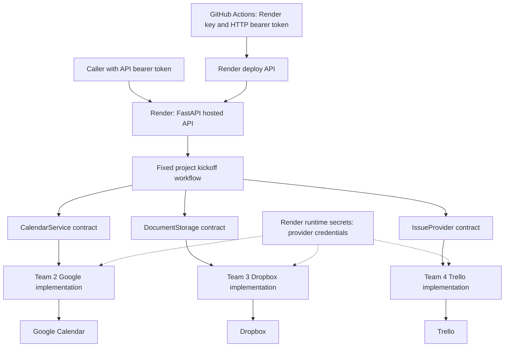
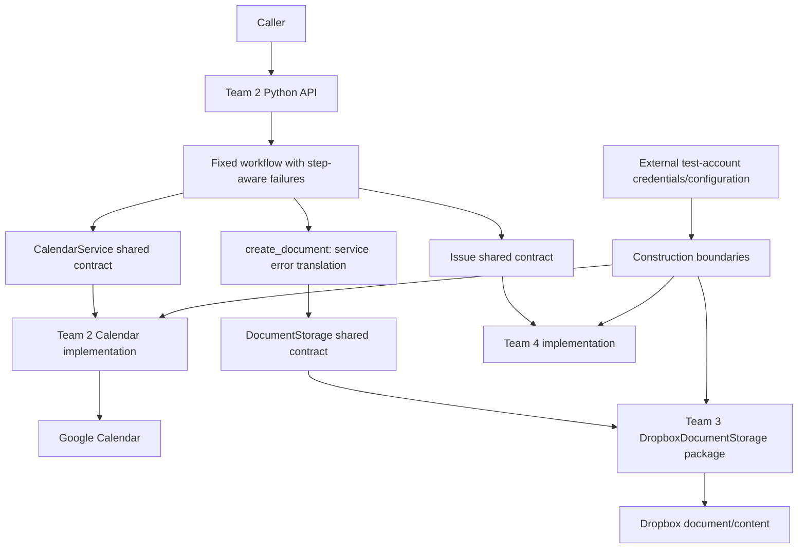

# Calendar and Three-Vertical Composition Design

## HW3 Milestone 2: agent service and model orchestration

The agent is a separate FastAPI service between the user interface and Team 2's
deterministic API. It interprets natural-language goals and selects tools, but it
does not import provider packages, receive provider credentials, authorize an
acting user, or execute a write from model text.

```text
Interface
    -> natural-language request
Agent service
    |- real or scripted ModelClient
    |- bounded explicit loop
    |- product ToolRegistry
    |- durable RunStore
    `- HTTP API client
             -> Team 2 API service
                     -> shared vertical contracts and provider implementations
```

The first model-assisted path builds on the existing project-kickoff scenario.
The model decides whether information is sufficiently explicit, asks for
clarification when a material field is missing, and may select the composed
proposal tool. Code validates the exact `ProjectKickoffRequest` and produces a
digest-bound proposal. The run then stops at `approval_required`; it does not
call the composed write endpoint. Level 4 will bind approval to the authenticated
user and exact proposal at the API execution boundary.

The only read tool retrieves a known event through `GET /events/{event_id}`.
This establishes the API-only execution path without exposing every provider
operation to the model. Tool output is bounded and marked untrusted before it
returns to the model. Retrieved issue, document, or event text cannot modify the
registry, identity, approval, limits, or system policy.

### Model versus code

| Model judgment | Deterministic code |
|---|---|
| Interpret the natural-language goal | Validate all request and tool schemas |
| Decide whether a material choice is ambiguous | Reject unknown tools and extra/model-supplied identity fields |
| Select a registered read or proposal tool | Enforce the registry, budgets, cancellation, and proposal-only writes |
| Produce a concise clarification or summary | Call only the API service and sanitize failures/results |
| Decide when a useful explanation is complete | Persist the run, proposal, trace, usage, and stopping reason |

`ModelClient` isolates the real OpenAI Responses implementation from the loop;
`ScriptedModel` supplies the same contract for deterministic CI. The real adapter
uses a versioned application instruction and structured response schema. It
passes no provider credentials or acting-user identifier. The configured model,
prompt version, exact tool-definition digest, reported usage, duration, outcome,
and failure are retained for evaluations.

### Stopping, persistence, and safety

The loop stops for completion, clarification, approval, policy block,
cancellation, model failure, or explicit step/time/token/available-cost limits.
Unknown or malformed tool calls become safe observations the model may correct
within the remaining budget; they never reach the API or providers.

SQLite is the development implementation of `RunStore`. It persists stopped
runs, exact proposals, sanitized traces, and cancellation across process
restarts, proving the persistence boundary without introducing another framework.
It is not the final multi-user database. Authentication/database owners must
scope this seam to the verified user and replace or configure it for deployment.

Trace entries identify model calls, tool names/call IDs, outcomes, policy
decisions, duration, model version, stopping reason, and usage. They exclude raw
authorization headers, provider credentials, provider payload dumps, and private
chain-of-thought.

### Decisions and tradeoffs

| Constraint | Decision | Tradeoff / revisit condition |
|---|---|---|
| Keep the model outside deterministic execution | Separate `agent_service` process calling the API over HTTP | Two processes require deployment wiring; do not merge them merely for convenience |
| Prevent premature writes | The composed tool creates only an exact proposal and exposes no apply endpoint | Complete approval/provider verification waits for Level 4 integration |
| Keep the loop inspectable | Small custom loop with two product tools instead of a general agent framework | Add framework features only after a measured failure requires them |
| Test without credentials | Shared protocol with `ScriptedModel`; SQLite and controlled API boundary | Scripted success does not prove real-model quality |
| Avoid prompt injection becoming authority | Mark tool results untrusted and enforce tools/policy in code | Model summaries may still be poor; deterministic boundaries contain effects |

### Evaluation status

Deterministic tests exercise read-tool feedback, exact write proposals,
clarification, unknown/malformed calls, model/API failure, cancellation, restart,
step/time/token limits, and adversarial retrieved content. Executable evaluation
definitions record initial state, allowed actions, stopping conditions,
observable success, prohibited effects, model/prompt versions, exact tool digest,
duration, usage, and failure.

Five-run real-model evidence, a real-model adversarial run, a measured
before/after improvement, authenticated approval execution, and provider
read-back are not claimed yet. They require real model credentials and the Level
4 identity/approval path. The current remaining design limitation is the
single-process SQLite development store. See [AGENT.md](AGENT.md) for operations
and exact evidence procedures.

## HW3 deployment and request trace (#85)

The [deployment runbook](HW3_DEPLOYMENT.md) is the configuration, hosted usage,
verification, cleanup, and evidence source of truth. HW2 evidence below remains
historical; it does not certify the new three-provider operation.



Provider credentials remain behind the hosted service boundary. The caller only
needs the HTTP bearer token. GitHub builds the locked image and selects its
digest; provider credentials are neither baked into layers nor sent to callers.
The workflow uses small capability protocols over the shared contract packages;
concrete package construction is owned by the configuration boundary.

### Implemented request trace

The automated workflow and HTTP integration tests verify this request path. The
values below are illustrative rather than retained hosted-provider evidence.
Consider the request in [HW3_DEPLOYMENT.md](HW3_DEPLOYMENT.md#run-the-deployed-operation)
with `UNIQUE-MARKER=example-001`. HTTP validation rejects bad fields before
provider construction. Issue Tracker, Calendar and Storage are preflighted and
owned by an `ExitStack`; no write has happened at this point.

1. Storage creates `/kickoff-example-001.md` with the supplied UTF-8 text. Its
   returned document ID/path becomes `storage.outcome=succeeded`. The create-only
   stable path is the request claim for later manual resubmission.
2. Issue Tracker creates `Project kickoff example-001`. Its ID/title becomes
   `issue_tracker.outcome=succeeded`; Calendar is still not attempted.
3. Calendar creates the kickoff event for 2030-01-07 15:00–15:30 UTC. Its Event
   becomes `calendar.outcome=succeeded`. HTTP 201 returns all three result objects.

The caller supplies the related text; this implementation does not automatically
insert the returned Calendar ID into the document or the document ID into the
card. Each result is preserved in the combined response. All request-scoped
clients close when the dependency exits.

If Storage fails, both Issue Tracker and Calendar remain unattempted. If Issue
Tracker fails, the confirmed Storage document remains and Calendar is not
attempted. If Calendar fails, both prior results remain. No automatic compensation
or replay occurs. The client must inspect provider state before resubmission.

### Deployment decision

Constraint: HW3 must reuse the HW2 delivery path. Keep the existing image-backed
Render service and digest-based Delivery workflow, changing the integration
branch and adding external runtime configuration. A second independent pipeline
would duplicate release/rollback controls; another production instance would
split URLs and credentials. The tradeoff is that changing the shared service
can affect teammates, so stage configuration and coordinate rollout. Revisit
separate staging when concurrent demonstrations or incompatible runtime settings
require isolation. The deployment probe still verifies Calendar; the separate
opt-in composition check and direct provider inspection establish HW3 evidence.


## HW3 Milestone 1: workflow configuration and partial failure (#84)

Current behavior extends #80's fixed `POST /workflows/project-kickoff`, reusing
#81's Calendar entry point and #82's shared storage factory. The workflow remains
Storage -> Issue Tracker -> Calendar; provider selection lives in
`app/workflow_composition.py`, not orchestration. Public failure states and retry
semantics are canonical in [CONTRACT.md](CONTRACT.md#failure-and-progress-response-84).
No API consumer should infer exactly-once execution from these progress fields.

| Configuration | Supported behavior |
| --- | --- |
| `WORKFLOW_IMPLEMENTATION` unset or `configured` | Real construction boundaries; no fake fallback |
| `CALENDAR_IMPLEMENTATION` unset or `team2` | Existing #81 selection, unchanged |
| `STORAGE_IMPLEMENTATION=team3` | Existing #82 package/credentials/retry policy, unchanged |
| `ISSUE_TRACKER_IMPLEMENTATION=team4-trello` | Tagged Team 4 provider with Trello configuration; see [handoff](ISSUE_TRACKER_HANDOFF.md) |
| `WORKFLOW_IMPLEMENTATION=controlled` plus `WORKFLOW_FAIL_STEP=calendar`, `storage` or `issue_tracker` | Credential-free synthetic workflow; chosen step is rejected with 403, earlier synthetic results retained, later steps not attempted |

Missing/invalid controlled-step selection fails closed; `WORKFLOW_FAIL_STEP`
is rejected in configured mode rather than silently ignored. The controlled
mode deliberately exercises failure reporting only. It does **not** stand in
for two different teams' packages or actual provider-created records.

### Resource ownership and #83 handoff

`get_project_kickoff_workflow(request)` receives the same validated body as the
route so invalid input cannot trigger construction/authentication. An `ExitStack`
preflights all constructors before yielding the workflow and releases acquired
resources in reverse order on success or failure. Construction order is Issue
Tracker, Calendar, Storage; execution order is Storage, Issue Tracker, Calendar.
A missing Issue Tracker
integration therefore cannot start Google/Dropbox setup or create partial data.

`StorageCreator` is a narrow boundary adapter: it calls #82's existing
`create_document` helper to preserve typed error mapping and uncertain-write
semantics, not to copy provider code. Calendar uses `open_calendar_service()`.
`open_issue_creator()` selects the tagged Team 4 Trello provider explicitly,
checks required configuration before other setup, and owns cleanup. Its adapter
maps shared Issue Tracker errors to existing service errors. Missing selection
or configuration reports 503 at Issue Tracker setup before any writes. See
[handoff](ISSUE_TRACKER_HANDOFF.md) for configuration and verification limits.

### Decisions and safety boundaries

| Constraint | Choice | Alternative / accepted tradeoff / revisit |
| --- | --- | --- |
| Preserve results when a later call fails | Typed per-execution progress and a composition-only error extension; catch/sanitize each vertical call and result validation | Plain error loses earlier IDs; automatic compensation can destroy data. No database/resume/exactly-once claim; revisit only with an explicit idempotency/persistence requirement. |
| Unsafe replay after a committed or uncertain write | Use the create-only Storage path as the first claim; stop immediately, never retry or roll back writes; operation errors advertise `retryable=false` | A repeated path conflicts before downstream writes, reducing duplicate Calendar/Issue risk. A conflict still does not prove matching content or full success; callers must reconcile. |
| Every stage must be testable without credentials | Explicit controlled configuration implementing the same narrow capabilities | Hidden fallback would masquerade as real success. Controlled results use `controlled-*` IDs and never prove a package swap; keep real-provider verification separate. |

Known input/access/not-found failures are rejected; provider-error/unavailable
write outcomes are conservatively uncertain absent proof of non-commit. An
unexpected exception or malformed result is also sanitized as uncertain
`provider_error`, retaining prior confirmed results. Broad catches are limited
to these operation/setup boundaries, where losing progress would make retry
risk invisible; they are not a generic exception-swallowing policy.

### External design review — Faisal (Team 6)

Faisal identified three substantive issues: Calendar-first execution left an
avoidable duplicate-write risk on manual resubmission; portable Storage path and
content validation occurred too late; and a Storage conflict lost its useful
reconciliation meaning at the workflow error boundary.

The review was accepted and addressed by:

- changing execution to Storage → Issue Tracker → Calendar so the stable,
  create-only path acts as the first request claim;
- validating portable path segments and the 150,000,000-byte UTF-8 content limit
  before dependency construction while preserving submitted path case;
- exposing a pre-existing path as non-retryable workflow HTTP 409 `conflict`
  with fixed reconciliation guidance and complete step metadata.

The service still has no automatic resume, rollback or exactly-once guarantee.
An uncertain Storage response requires inspection, and case equivalence remains
provider-dependent because the shared Storage contract does not standardize it.
These changes record the response to the review; they do not claim Faisal's
subsequent approval.

### Genuine swap limitation and verification

The shared contract remains tagged `0.3.1`; Team 3 remains `v0.3.0` with the
existing lockfile. No new dependency, provider registry, Python/framework
upgrade, HTTP call to another team's deployment or copied SDK implementation is
introduced. [STORAGE.md](STORAGE.md#dependencies-and-selection) records the
candidate compatibility findings. Rechecked Team 1 `v1.1.0` lacks installable
project metadata, and Team 6 `v0.1.0` requires Python >=3.13 and incompatible
FastAPI/Uvicorn ranges. Do not silently patch around them or count a controlled
fake as another team's implementation. A compatible second package and its
actual deployed config-only swap demonstration remain external acceptance work.

[TESTING.md](TESTING.md#hw3-workflow-failure-and-configuration-84) maps the
credential-free checks. Team 4 installation, configuration, adapter behavior,
and provider-backed Trello verification are documented in the handoff. The hosted
three-provider run, real package swap, and external-team design review remain
evidence limits tracked in [HW3_DEPLOYMENT.md](HW3_DEPLOYMENT.md).

## HW3 Milestone 1: Calendar composition entry point (issue #81)

The agreed fixed workflow creates a Calendar kickoff event, saves a related
document, creates a related issue, and returns the combined result. This issue
supplies only the Calendar construction boundary; #80/#84 now provide the fixed
orchestration, step reporting and combined HTTP response described above.

`app.composition.open_calendar_service()` is a synchronous context manager
yielding the existing shared `CalendarService`. Set
`CALENDAR_IMPLEMENTATION=team2` to select Team 2 explicitly; an unset variable
also selects Team 2. Any other value, including an empty value, raises a sanitized
`ValueError` before client construction. There is no fallback to another team's
Calendar service. Existing Calendar HTTP dependencies and routes are unchanged.

The composition owner can acquire this service at the configuration boundary and
pass it to workflow code typed against `calendar_contract.CalendarService`:

```python
from calendar_contract import CalendarService, CreateEvent, Event
from app.composition import open_calendar_service


def create_kickoff(calendar: CalendarService, request: CreateEvent) -> Event:
    return calendar.create(request)


request = CreateEvent(
    title="Project kickoff",
    start="2030-01-15T10:00:00Z",
    end="2030-01-15T10:30:00Z",
)
with open_calendar_service() as calendar:
    event = create_kickoff(calendar, request)
```

This example performs a real write when run with configured credentials; it is
not a new endpoint. Validate the shared request before acquiring the service.
Only shared request, Event, and CalendarError values cross the consumer boundary:

```text
configuration: open_calendar_service()
    -> existing CalendarServiceAdapter
    -> application / cached EventProvider
    -> existing GoogleCalendarProvider

workflow: CalendarService.create(CreateEvent) -> Event or CalendarError
```

The existing tagged `calendar-contract` dependency remains unchanged. Reusing
the adapter avoids duplicating models, provider translation, or authentication.
The entry point owns one Google client per context and closes it on success or
failure. Use it within one synchronous workflow execution; do not retain or share
the service across worker threads. Configuration and Google construction stay in
the existing composition/provider modules, outside orchestration code.

Local credentials, token paths, calendar selection, and write permission use the
existing [provider setup](PROVIDER.md#local-setup). Set `GOOGLE_CALENDAR_ID` to the
designated test calendar. Hosted execution continues to use the externally
supplied secrets and noninteractive setup in [DEPLOYMENT.md](DEPLOYMENT.md).
No new credential format, dependency, or deployment resource is introduced.

Shared Calendar errors propagate unchanged, including code and `retryable`.
The entry point does not retry writes or perform rollback. Storage runs first,
then Issue Tracker, then Calendar. A later failure retains the confirmed earlier
results, and callers must not replay the whole workflow merely because a later
error is retryable. A lost Calendar write response can leave an event without a
returned ID after Storage and Issue Tracker have succeeded; it raises
`provider_error` with `retryable=false` and requires reconciliation before
another create.

Controlled creation, failure, cleanup, and configuration checks are described in
[TESTING.md](TESTING.md#hw3-calendar-composition). The Team 3 and Team 4 package
integrations, public partial-failure rendering, and deployment configuration are
implemented and covered by automated tests. The hosted three-provider run,
direct provider checks, and cleanup are recorded in HW3_DEPLOYMENT.md. The
genuine second-package swap remains an evidence limit.

## HW3 Milestone 1: storage integration (#82)

This section establishes the storage portion of service composition. The
remaining sections retain the HW2 design and its historical verification/review
records. The HW3 workflow/failure behavior is described in the #84 section
above. The storage package's real Dropbox verification passed, the complete
configured workflow is covered by automated tests, and the hosted
three-provider run and external review are recorded in HW3_DEPLOYMENT.md and
the external-review section above. The second-package swap remains an evidence
limit.



Storage consumes the authoritative contract at tag `0.3.1` and Team 3's
implementation at `v0.3.0`. Package metadata differs from tag names; exact
commits, candidate evaluation, configuration, and verification procedures are
canonical in [STORAGE.md](STORAGE.md).

`app/storage_composition.py` selects `STORAGE_IMPLEMENTATION=team3`, builds the
implementation, disables automatic SDK retries, and owns session cleanup.
`app/storage.py` accepts only the shared interface, creates once, returns shared
metadata, and translates typed storage errors into existing Team 2 errors.
No Calendar interface behavior changes. The composed route attaches failed-step
information and preserves prior results through the workflow error contract.

### Storage request trace and validation

For an example workflow request, the storage step receives a stable path such as
`/hw3-meeting-123.md` and caller-supplied UTF-8 summary bytes. It runs before
Calendar, so document content never depends on a provider-generated event ID.
`create_document` calls `DocumentStorage.create(path, content)`. Team 3 validates
absolute paths without empty, `.` or `..` segments, then creates without
overwrite/autorename and returns shared `FileInfo`. The workflow retains this
metadata for its combined result and subsequent issue step. Controlled tests
verify exact stored/downloaded bytes and returned shared metadata.

The HTTP request model applies those portable path rules and the selected
implementation's 150,000,000-byte UTF-8 ceiling before any provider is built.
It preserves path case because the shared contract does not define case
equivalence: Dropbox is case-insensitive while another implementation may not
be. Callers must reuse the exact path spelling for reconciliation. Provider
validation remains behind the shared boundary as defense in depth. Configuration
selection is validated before credential loading. Credentials remain external;
workflow code does not import provider SDKs.

### Integration decisions

| Constraint | Chosen approach | Credible alternative | Accepted tradeoff / revisit condition |
|---|---|---|---|
| Use another team's installable implementation on Python 3.12 | Team 3 `v0.3.0` through authoritative `DocumentStorage` | Team 1 or Team 6 package | Three package Git sources; revisit when another team's compatible package is available. Hosted HTTP is excluded by the TA clarification. |
| Implementation choice must stay out of orchestration | Small environment-selected construction function | Generic plugin registry | Only one supported storage selection today; add a factory branch and dependency for the eventual swap, without changing orchestration. Revisit a registry only if concrete selection complexity warrants it. |
| A write error does not prove no record exists | Create-only stable path, no automatic SDK/application retries, explicit uncertain-write exception | Blind replay or compensating deletion | Caller/workflow retains progress and reconciles before retry. No exactly-once guarantee; revisit if the shared contract adds idempotency/reconciliation guarantees. |

### Partial failure and evidence

If storage fails, mark it failed for a known rejection or uncertain for a
provider/transport failure; leave Issue Tracker and Calendar not attempted.
`StorageWriteUncertainError` carries existing `provider_error` with
`retryable=false`. If Storage succeeded and Issue Tracker fails, preserve its
`FileInfo`; if Calendar fails last, preserve both earlier results. Do not replay
completed writes. A pre-existing path is exposed as workflow-only HTTP 409
`conflict`, distinct from malformed input. Reconcile the stable path using
`get_metadata` and `download`, then compare exact bytes before deciding whether
manual continuation is safe. A conflict alone is not proof of success.
There is no workflow-state persistence or automatic rollback in this issue.

Controlled verification exercises the actual installed package over a controlled
SDK, including a write committed before its response is lost. The opt-in live
storage test passed against Dropbox on 2026-11-16, confirming exact content,
duplicate refusal, and cleanup. Automated tests verify the configured three-step
workflow and step-aware failures at every stage. The hosted three-provider API
run and Faisal's external review are recorded; only the genuine different-team
storage-package swap remains an evidence limit. See
[storage verification](STORAGE.md#verification).

## Milestone 3 delivery

Issue #69 adds delivery to #68's Render image-backed infrastructure. Merges to
`assgn2-ms3-submission` run canonical checks, controlled shared conformance and
Blueprint schema validation, then build/test one linux/amd64 image and deploy
its published digest. Protected delivery requires real shared-API CRUD smoke
and confirmed cleanup before success. Manual dispatch restores a retained digest
without rebuilding using the same code. Runtime config stays in Render; PRs
receive no deployment credentials. [DELIVERY.md](DELIVERY.md) is canonical for
setup, failure handling and rollback. Live delivery/recovery verified.

## Milestone 3 observability

The four shared CRUD operations retain their existing routes, application/cache
behavior, and Google provider semantics. `app/telemetry/` supplies bounded OTLP
metrics/logs/traces through the application factory's lifespan and ASGI middleware.
Google Create/Get/Replace/Delete operations have CLIENT spans including response
translation; PUT's fresh GET preflight is a separate span. Cache hits have no
outbound span. Success requires the operation's exact contract status, and
unexpected 2xx/3xx responses use `unexpected_status` for reliability consumers.
No body, raw identifier, provider payload, or exception text is exported.
Saturation measures occupied AnyIO workers relative to the actual worker limit.
Configuration, golden-signals dashboard, hosted-lifecycle integration, Level 4
schema, and deployed evidence are canonical in
[OBSERVABILITY.md](OBSERVABILITY.md). Listing and PATCH remain supported extensions.

| Metadata | Value |
|---|---|
| Authors | Alexander Freedman and OSPSD Team 2 |
| Team / vertical | Team 2 / Calendar |
| Team reviewers | Alexander Freedman (`Airbus-A330`) and Leon Liu (`LeonLiu0204`) — complete Team 2 design review |
| Cross-team reviewer | Karthik Ganeshan, Team 7 (contract-facing review comments addressed) |
| Status | Implemented, deployed, and reviewed; exact-commit CI/tag/release remain |
| Last updated | 2026-11-12 |
| Shared revision | [`v0.1.0-rc.1`](https://github.com/Airbus-A330/OSPSD-Calendar/tree/v0.1.0-rc.1), commit `1c1cad7a0732ddb242a05400d8833d94e4422424` |
| Shared HTTP contract | [`docs/HTTP_CONTRACT.md`](https://github.com/Airbus-A330/OSPSD-Calendar/blob/v0.1.0-rc.1/docs/HTTP_CONTRACT.md) |
| Joint decision memo | [Local preserved copy](JOINT_CALENDAR_CONTRACT.md) |
| Implementation | [Migration pull request](https://github.com/Airbus-A330/OSPSD-Team-2/pull/60) |

### Review record

Alexander Freedman (`Airbus-A330`) and Leon Liu (`LeonLiu0204`) reviewed the
complete Team 2 design. Leon's review covered architecture and component
responsibilities, shared-contract mapping, the Google provider boundary, failure
handling, deployment and rollback, observability, reliability, and implementation
evolution. Substantive feedback from the full-design review was dispositioned
through the final implementation and documentation. Karthik Ganeshan's Team 7
review remains the separate contract-facing review.

## Scope and status

This design covers Team 2's four common HW2 operations: POST, GET-one, PUT,
and DELETE. Issue #67 completes the application integration begun with GET-one.
It was prepared from the final HW1 service, the HW1 architecture review, and the
[joint Calendar contract](JOINT_CALENDAR_CONTRACT.md) agreed by Teams 2, 5, and
7.

The shared implementation is maintained in the
[`OSPSD-Calendar`](https://github.com/Airbus-A330/OSPSD-Calendar) repository.

The service depends on the immutable shared-package release-candidate tag
[`v0.1.0-rc.1`](https://github.com/Airbus-A330/OSPSD-Calendar/tree/v0.1.0-rc.1),
which resolves to commit `1c1cad7a0732ddb242a05400d8833d94e4422424` and
declares package version `0.1.0`. It does not depend on `master` or another
moving branch.

## Context

The HW1 service has six provider-backed operations, a provider-independent
application boundary, deterministic tests, and an optional read cache. The HW2
contract standardizes four operations, shared request/response models, shared
service errors, and conformance tests across three Calendar teams.

The HW1 review also identified structural debt:

- application and test modules were mostly flat;
- `main.py` combined startup, composition, validation, and routing;
- validators and error rendering communicated through hidden `request.state`
  fields;
- HTTP dependencies repeated validation performed by application functions;
- Google failures were logged only after reaching the HTTP boundary;
- module-level Google helpers had the same names as provider and application
  operations;
- two test modules were named for being "final" rather than for their behavior.

## Goals

1. Consume an immutable shared package release reproducibly.
2. Route all four common operations through the shared CalendarService interface.
3. Preserve real Google Calendar retrieval and the existing cache behavior.
4. Keep Google SDK objects and configuration behind the provider boundary.
5. Make HTTP routing, request validation, application behavior, composition,
   and provider integration independently understandable.
6. Log safe Google operation and status context where provider failures occur.
7. Pass the complete tagged conformance suite through Python and HTTP.

## Non-goals

This integration does not standardize Team 2's optional listing or PATCH extensions,
add another real provider, add a dependency-injection framework, redesign the
cache, add retries, or perform a speculative rewrite of every operation.

## Main tradeoff: consume the tagged shared package

Team 2 consumes the tagged `calendar-contract` package and adapts its existing
application/provider code to the shared `CalendarService`, rather than copying
the shared models into this repository. Copying would reduce the immediate Git
dependency and let Team 2 change models independently, but it would recreate the
cross-team drift that Assignment 2 is intended to remove.

The chosen approach is supported by the same conformance implementation running
against Teams 2, 5, and 7 and by Team 2's full controlled Python/HTTP conformance
run. Its cost is release coordination: an upstream tag must remain available,
`pyproject.toml` and `uv.lock` must agree, and a shared semantic change cannot be
adopted unilaterally. Revisit this decision only if the three Calendar teams
approve a new incompatible contract revision or the shared package can no longer
be installed reproducibly; either case requires a new reviewed tag, lockfile
update, and conformance run before deployment.

## Current architecture

The HW1 request flow is:

```text
FastAPI route and validation in main.py
    -> application function in events.py
    -> EventProvider
    -> CachedEventProvider
    -> GoogleCalendarProvider
    -> Google Calendar SDK
```

The boundaries are conceptually sound, but the entry point formerly contained
all routes and validation dependencies. Error presentation depended on
request-local flags written by several functions, and Google exceptions were
translated without a provider-layer log describing the failed operation.

## Target architecture

```text
app/main.py                 application creation and handler registration
    -> app/api/routes.py    thin HTTP routes
    -> app/api/validation.py HTTP-only early validation
    -> CalendarService      shared create/get/replace/delete boundary
    -> app/calendar_service.py adapter to existing application operations
    -> app/events.py        provider-independent application behavior
    -> app/providers.py     Team 2 provider extension boundary
    -> app/event_cache.py   optional domain-event cache wrapper
    -> app/google_calendar.py Google SDK adapter and translation

app/composition.py          concrete provider selection and request lifetime
app/http_errors.py          public error rendering and HTTP failure logging
calendar-contract           shared core models, errors, and CalendarService
```

`main.py` no longer owns provider construction, validators, or route functions.
HTTP error rendering derives the operation from the matched route and receives
explicit error context; it does not read validator-written `request.state`
fields. Google failures are logged inside the Google adapter with only the
operation and numeric status when available. Event IDs, provider payloads,
credentials, exception text, and request headers are excluded.

## GET request flow

```text
GET /events/{event_id}
    -> validate_get_request rejects a blank ID before OAuth/client setup
    -> get_event_provider composes a request-scoped Google client
    -> get_calendar_service wraps the provider as a CalendarService
    -> read_event calls CalendarService.get with the validated ID
    -> CalendarServiceAdapter delegates to application get_event
    -> CachedEventProvider serves a hit or delegates
    -> GoogleCalendarProvider executes events.get
    -> provider response is translated to the domain Event
    -> FastAPI serializes the shared Event response shape
```

The HTTP dependency is the authoritative blank-ID validation point for this
migrated route. The application operation retains optional validation for
non-HTTP callers, while the route explicitly skips the duplicate check after
the dependency has succeeded. Non-HTTP consumers construct
`CalendarServiceAdapter(provider)` with ID validation enabled by default. The
HTTP composition opts out only after the route's early ID validation, retaining
the existing request-scoped client cleanup and cache.

## Shared API and model mapping

The shared release-candidate tag is pinned and locked with uv. All common
operations consume shared runtime models, errors, and the service interface:

| Shared package | Team 2 use |
|---|---|
| `Event` | All response and provider translation models |
| `CreateEvent` | POST input, passed unchanged through adapter/application/provider |
| `ReplaceEvent` | PUT input, passed unchanged through adapter/application/provider |
| `CalendarError` / `ErrorCode` | Expected failures and common HTTP error rendering |
| `CalendarService` | All four common routes depend on this interface |

`CreateEventRequest` and `EventReplacement` are import aliases for shared models,
not local schemas. The adapter no longer converts between competing models.
Shared validators enforce strict strings, nonblank write titles, RFC 3339 with
explicit offsets, increasing ranges, and rejected unknown fields. The application
adds no title-length limit or fractional-second truncation. HTTP validates before
client setup; non-HTTP callers construct the same validated shared models.
Existing service exception names subclass `CalendarError` for compatibility and
add only local context; they do not define different core codes or retry semantics.

Team 2's list limit and `EventPatch` remain local extensions. Their legacy error
envelopes and validation behavior are retained; they are not requirements of the
shared core. No provider SDK types cross the domain boundary.

POST and PUT parse the shared model before resolving `get_calendar_service`,
then call `create` or `replace`. DELETE validates the ID before calling `delete`.
The adapter delegates to the existing application operations and cached provider.
Google PUT performs its existing uncached preflight so a cancelled/missing event
cannot be revived. The cache invalidates across mutations and uncertain failures.

## Failure behavior

The shared contract requires `invalid_input`, `not_found`, `access_denied`,
`provider_error`, and `provider_unavailable`, including required `retryable` in
the HTTP error body. HTTP status mapping remains a Team 2 HTTP concern;
provider code raises shared errors rather than returning HTTP responses.

Representative successful request and sanitized response:

```http
GET /events/example-event
```

```json
{
  "id": "example-event",
  "title": "Team sync",
  "start": "2026-11-04T15:00:00Z",
  "end": "2026-11-04T15:30:00Z"
}
```

An untitled provider event returns the same response with `"title": ""`. The
example is synthetic, not a capture from a private calendar. The procedure for
recording a sanitized live response is in [PROVIDER.md](PROVIDER.md).
[The observed GET verification](HW2_MS2_GET_VERIFICATION.md) records a real
HTTP-to-Google success and missing-event run with the shared adapter, including
the tested source revision, redactions, and reproduction steps.

Google HTTP and transport failures are logged before translation using safe
operation context. HTTP logging records the public operation, shared code,
status, and whether the error explicitly indicates provider involvement. No
layer logs credentials, authorization headers, raw payloads, event IDs, or
provider error messages.

| Google/read outcome | HTTP | Shared code | `retryable` |
|---|---:|---|---:|
| Missing event | 404 | `not_found` | `false` |
| Permission denied | 403 | `access_denied` | `false` |
| Invalid or unexpected success payload | 502 | `provider_error` | `false` |
| Quota/rate limit, 5xx, or transport failure on GET | 503 | `provider_unavailable` | `true` |
| Invalid path input | 422 | `invalid_input` | `false` |

All common routes render the shared envelope, including `retryable`. Malformed,
non-JSON, or empty bodies return 400; valid JSON violating a schema/value rule,
unknown fields, and blank path IDs return 422. Messages are fixed and sanitized.

Confirmed Google quota refusals (429 or 403 with a limit reason) become 503
`provider_unavailable`, including on writes. Setup/preflight failures before a
mutation can also be safely classified as unavailable. Write transport failures,
5xx, and invalid success payloads instead use 502 `provider_error` with
`retryable=false`: the mutation may have taken effect. Reads map temporary 5xx
and transport failures to unavailable. No operation automatically retries.
DELETE retains 404 for absence and Google's explicit 410 `deleted` response.

## Operational considerations

Google OAuth files remain local and ignored. Each request owns and closes its
Google client because its HTTP transport is not safe to share across worker
threads. The process-local cache continues to share domain `Event` values only;
it does not retain SDK objects. The migration does not change cache TTL,
capacity, invalidation, or concurrency behavior.

### Container and deployment foundation (issue #68)

The local implementation uses one Render **Free** image-backed web service,
one worker, and ephemeral storage, following Alexander's November 9 clarification.
`Dockerfile` uses digest-pinned Python/uv bases and locked application dependencies.
The Blueprint in `infra/render.template.yaml` takes an immutable published image
reference and does not provision a disk or database. See
[DEPLOYMENT.md](DEPLOYMENT.md) for bootstrap, preview/reapply, cost limits and teardown.

The hosted entry point, `app.hosting:app`, validates runtime authorization and
initializes a private disposable token cache on every start without contacting
Google. Render's protected runtime JSON is the source for restart recovery;
operator credential updates replace stale cached state on restart. The service
requires bearer authorization for API traffic and exposes provider-independent
`/healthz` and `/readyz`. Local development retains `app.main:app`. Refresh is
serialized between threads and cached atomically, without interactive login.

Free instances sleep on idle, lose local files across restarts, and have cold-start
latency and usage limits. Credential expiry/revocation requires updating the
runtime secret. The pipeline/smoke tests (#69) and SLO work must account for these
constraints without blindly retrying writes. Calendar data remains in Google.

The hosted service has been deployed through the immutable Delivery path and
verified with real-provider smoke/cleanup. Dorien Zhang, Nicolas Ollivier, and
Leon Liu completed the human verification session covering fresh-checkout setup,
preview, shared-API reachability, unchanged synchronization, and teardown-
procedure review. Render Hobby workspace access limitations remain a documented
operational constraint; protected routine changes use the GitHub/CD path.

## Testing

Fast tests control provider or SDK boundaries and require no credentials or
network. `tests/integration/test_shared_conformance.py` inherits the entire tagged
`CalendarServiceConformance`, running against the production adapter/cache/Google
integration both directly and through HTTP. A stateful SDK fixture models remote
records and deleted tombstones; upstream fixtures create and clean up isolated
data. Failure injection occurs at SDK calls, including after a mutation, so tests
exercise actual Team 2 translation rather than injecting pretranslated errors.

`tests/integration/test_shared_http.py` tests the 400/422 distinction, strict
shared values, unknown fields, unchanged accepted strings, and safe error bodies.
Shared-only substitutes prove that all four routes depend on `CalendarService`.
Existing tests retain listing/PATCH and cache coverage. The existing `make test`
and Tests CI collect the entire suite without workflow changes.

The opt-in `tests/live/test_shared_workflow.py` exercises real POST → GET → PUT →
GET → DELETE, then repeated DELETE, missing GET and missing PUT. Reads bypass
cache expiration, and cleanup runs in `finally`. The canonical Delivery smoke
subsequently exercised this real provider-backed workflow and confirmed cleanup;
retained evidence is in [evidence/reliability-live](evidence/reliability-live/README.md).
The opt-in test remains separate from fast CI. [PROVIDER.md](PROVIDER.md#hw2-shared-workflow-verification)
documents setup, the exact command, and cleanup limits for uncertain creation.

## Migration strategy

### Milestone 2 foundation (completed)

- preserve the joint memo separately from this Team 2 design;
- split routing, HTTP validation, and provider composition out of `main.py`;
- remove hidden `request.state` communication from validators/error rendering;
- avoid repeated validation on the migrated GET HTTP path;
- add sanitized provider-layer operation logging;
- rename ambiguous raw Google helpers;
- rename chronology-based test modules by behavior;
- pin and consume the shared release once an upstream tag exists;
- migrate GET success and failures to shared models/errors;
- verify GET with controlled tests and the documented live-provider procedure.

### Milestone 3 integration completion

Issue #67 completes shared create/replace/delete model and HTTP adoption and
full controlled conformance. Compatibility import aliases keep the diff focused;
shared models and validators remain the sole implementation for core writes.
Listing/PATCH remain supported local extensions.

### Release verification

The live workflow and cleanup, deployed telemetry, and bounded recovery exercise
are recorded. The infrastructure, operator, and three-case telemetry verification
session is also complete. Review and CI must still pass on the exact final merged
revision before the annotated tag and GitHub Release are created.

## Alternatives considered

### Depend on a branch or commit temporarily

Rejected. The milestone requires a tagged shared revision, and a moving branch
would make fresh-checkout reproduction unreliable. A commit pin would be
immutable but would not satisfy the explicit tagged-release requirement.

### Copy shared models into this repository

Rejected. Copying would preserve the duplication the shared package is meant to
eliminate and would allow the three services to drift.

### Migrate every operation in one change

Deferred at the Milestone 2 checkpoint to establish one clean vertical slice.
Issue #67 now completes the common operations using that existing architecture,
without rewriting the service or changing extension behavior.

### Add a dependency-injection container or provider registry

Rejected. FastAPI dependencies and ordinary Python parameters already provide
the required composition and test replacement points.

## Final review and release evidence

1. Retain the final merge commit and matching required CI links.
2. Create the annotated tag and GitHub Release only after those checks pass on
   the exact submitted revision.

## Change history

- 2026-11-09: changed #68 to Render Free without a persistent disk; restored OAuth
  cache from runtime configuration on each start and documented cold-start/access limits.

- 2026-11-09: added the container/Blueprint foundation, hosted startup validation,
  and health/access behavior. Later delivery and teammate verification supplied
  the cloud evidence recorded in the deployment documents.

- 2026-11-09: issue #67 routes all common operations through `CalendarService`,
  aliases shared write models, adopts shared HTTP errors and validation, and
  runs complete controlled conformance through Python and HTTP. The later
  Delivery workflow supplied the real-provider verification and cleanup evidence.

- 2026-11-04: proposed the Render deployment approach, tools, and operational
  assumptions later implemented for Milestone 3.

- 2026-11-04: routed GET through `CalendarService.get`, reused shared GET
  conformance cases with seeded SDK fixtures, and recorded real-provider HTTP
  verification of the adapter working tree.

- 2026-11-04: pinned and locked shared release candidate `v0.1.0-rc.1`.
- 2026-11-04: migrated GET response construction and error semantics to shared
  runtime types; added controlled untitled-event and temporary-outage coverage.
- 2026-11-04: incorporated Team 7 contract-facing review comments concerning
  error codes, `retryable`, 422 validation, temporary failures, untitled events,
  and uncertain writes.
